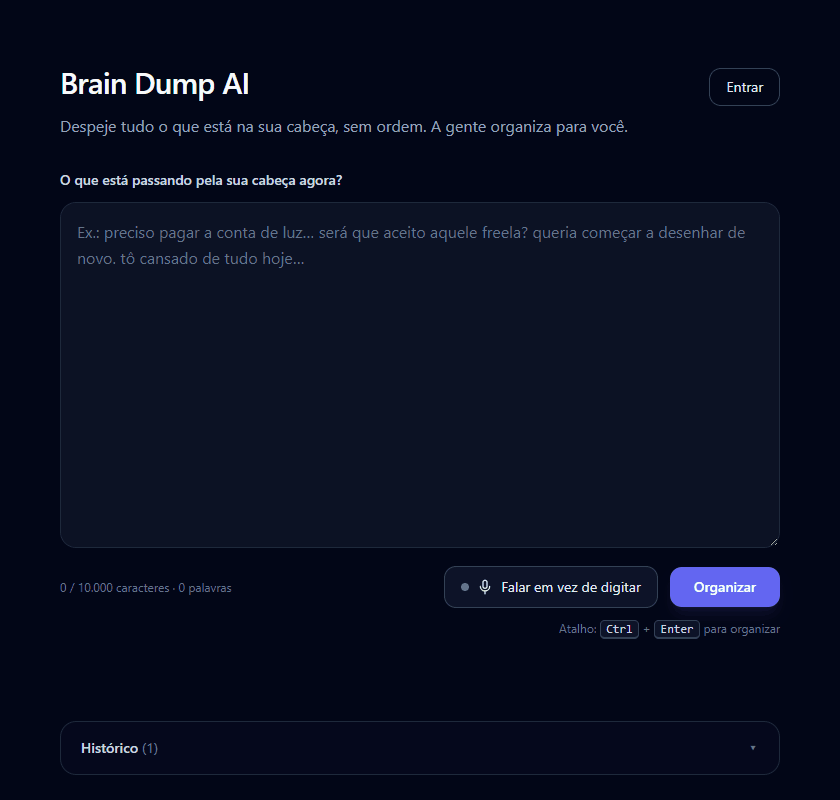
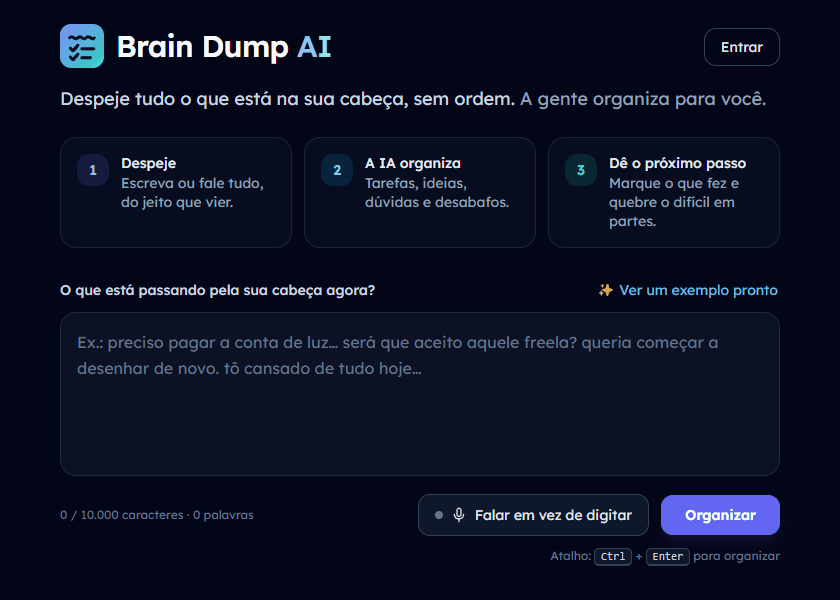
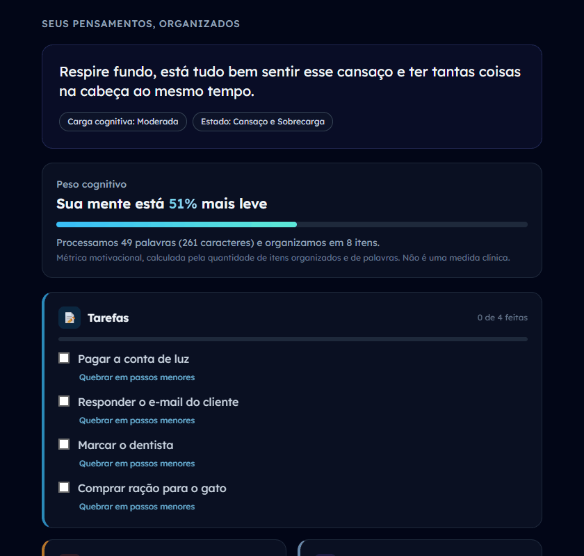
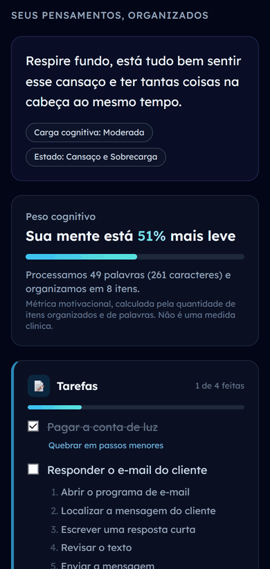
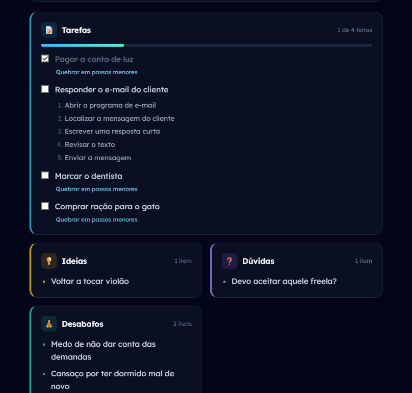
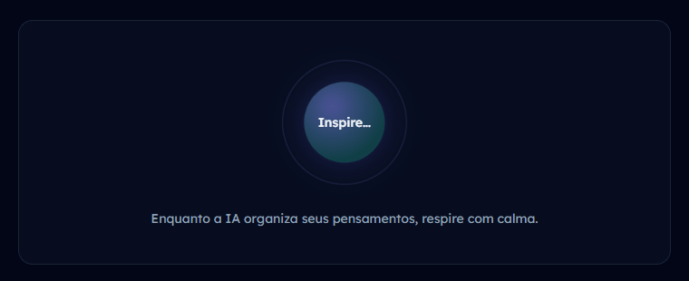
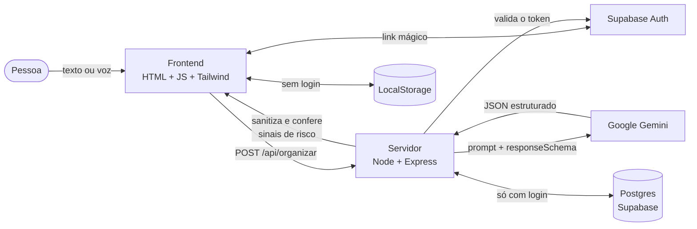

<div align="center">

# 🧠 Brain Dump AI

**Despeje tudo o que está na sua cabeça, sem ordem. A IA organiza para você.**

Um app de *brain dump* pensado para pessoas com **TDAH e ansiedade**: você escreve (ou fala) os pensamentos do jeito que vierem, e o Google Gemini os separa em **tarefas**, **ideias**, **dúvidas** e **desabafos**, com uma leitura acolhedora do seu momento.


[](https://github.com/Brenosspc/brain-dump-ai/actions/workflows/ci.yml)

### [🌐 Experimente agora: brain-dump-ai-tomp.onrender.com](https://brain-dump-ai-tomp.onrender.com)

<sub>Hospedado no plano gratuito do Render: o primeiro acesso depois de um tempo parado pode levar até 1 minuto para acordar o servidor.</sub>



</div>

> [!NOTE]
> Projeto de portfólio. Não é uma ferramenta clínica e não substitui acompanhamento profissional.

## 📌 Sumário

- [O problema](#-o-problema)
- [Funcionalidades](#-funcionalidades)
- [Capturas de tela](#-capturas-de-tela)
- [Como funciona](#-como-funciona)
- [Decisões técnicas](#-decisões-técnicas)
- [Como rodar](#-como-rodar)
- [API](#-api)
- [Segurança e privacidade](#-segurança-e-privacidade)
- [Estrutura do projeto](#-estrutura-do-projeto)
- [Limitações e próximos passos](#-limitações-e-próximos-passos)

## 💭 O problema

Quando a cabeça está cheia, organizar os pensamentos já é uma tarefa a mais. Listas de tarefas comuns pedem que você chegue com tudo separado e priorizado, e é justamente isso que fica difícil num dia de sobrecarga.

O Brain Dump AI inverte a ordem: **primeiro você esvazia a cabeça, do jeito que vier, e depois recebe tudo organizado**, com tarefas que começam por um verbo, sentimentos acolhidos sem julgamento e a opção de quebrar o que parece grande demais em passos pequenos.

## ✨ Funcionalidades

| | |
| --- | --- |
| ✨ **Ver um exemplo pronto** | Um clique mostra o app funcionando com um despejo de exemplo, **sem chamar a IA nem gastar cota**. |
| ✍️ **Escreva sem filtro** | Caixa de texto que cresce com o que você escreve, contador de caracteres e palavras, atalho **Ctrl + Enter**. |
| 🎙️ **Fale em vez de digitar** | Ditado por voz em português (Web Speech API), no Chrome e no Edge. |
| 🗂️ **Organização com IA** | 📝 Tarefas · 💡 Ideias · ❓ Dúvidas · 🧘 Desabafos, cada categoria com a sua cor e sem itens repetidos. |
| 🫁 **Respire enquanto espera** | Enquanto a IA trabalha, um círculo de respiração convida a inspirar e expirar com calma. |
| 💬 **Leitura do momento** | Síntese acolhedora, nível de carga cognitiva e estado mental. |
| 🪶 **"Sua mente está X% mais leve"** | Métrica motivacional (não clínica) baseada no que foi organizado. |
| ✅ **Checklist de tarefas** | Marque o que já fez, com uma pequena comemoração e uma barra de progresso; tudo fica salvo no histórico. |
| 🪜 **Quebrar em passos menores** | A IA divide uma tarefa difícil em 3 a 5 passos, começando por um bem fácil. |
| 💙 **Apoio quando precisa** | Se o texto mostra sofrimento intenso, aparece com delicadeza o contato do **CVV (188)**. |
| 📋 **Copiar só as tarefas** | Uma por linha, prontas para colar no seu app de lista. |
| 🔐 **Login sem senha** | Link mágico por e-mail para guardar o histórico na nuvem e abrir em outros aparelhos. Sem login, tudo fica só no navegador. |
| 📚 **Histórico com prévia** | Os últimos despejos mostram quantas tarefas, ideias e dúvidas tinham, e quantas tarefas já foram feitas. |
| ♿ **Pensado para foco** | Fonte **Lexend** (criada para facilitar a leitura), dark mode suave, navegação por teclado, leitores de tela e `prefers-reduced-motion`. |

## 📸 Capturas de tela

<table>
  <tr>
    <td colspan="2"></td>
  </tr>
  <tr>
    <td colspan="2" align="center"><sub>Tela inicial: o que o app faz em três passos e um exemplo pronto a um clique</sub></td>
  </tr>
  <tr>
    <td width="60%"></td>
    <td width="40%" rowspan="2" align="center"></td>
  </tr>
  <tr>
    <td></td>
  </tr>
  <tr>
    <td align="center"><sub>Resultado com cores por categoria e tarefa quebrada em passos menores</sub></td>
    <td align="center"><sub>Layout responsivo no celular</sub></td>
  </tr>
  <tr>
    <td colspan="2" align="center"></td>
  </tr>
  <tr>
    <td colspan="2" align="center"><sub>Enquanto a IA trabalha: um convite para respirar</sub></td>
  </tr>
</table>

## 🔄 Como funciona



1. O texto vai para o servidor, que monta o prompt e pede ao Gemini uma resposta **no formato exato de um schema** (`responseSchema`).
2. Se o modelo principal estiver sem cota, sobrecarregado ou lento, o servidor tenta um **modelo reserva** dentro de um prazo total de 30 s.
3. A resposta é **sanitizada** (só campos esperados, sem vazios nem repetidos) e passa por uma **rede de segurança** que procura expressões explícitas de risco para mostrar o cartão de apoio.
4. Com login, o despejo é salvo na conta; sem login, fica só no navegador.

## 🧩 Decisões técnicas

- **Saída estruturada, não texto livre.** Todas as respostas da IA usam `responseSchema`, então o frontend nunca precisa "adivinhar" o formato.
- **Modelo reserva com prazo.** O modelo principal tem 18 s; o que sobrar dos 30 s vai para o reserva. A cota diária esgotada é detectada pelo `quotaId` do erro, para mostrar uma mensagem honesta.
- **Duas camadas para o cartão de apoio.** A IA marca `sugerir_apoio`, e uma lista de expressões em `lib/apoio.js` cobre o caso de a IA deixar passar, sem disparar em expressões idiomáticas como "vai me matar de rir".
- **Login sem biblioteca de JWT no servidor.** O token é confirmado no próprio Supabase (`/auth/v1/user`), com cache de 60 s que guarda só o hash do token, nunca o token em si.
- **Dependências enxutas.** O backend usa só `express`, `@google/genai`, `pg` e `dotenv`. O frontend é JavaScript puro; o único build é o do Tailwind, que gera um CSS de ~17 KB só com as classes usadas (o arquivo gerado fica no repositório, então o app roda sem build).
- **Design com propósito.** A fonte Lexend foi criada para facilitar a leitura; o loader de respiração troca a espera ansiosa por uma pausa; cada categoria tem uma cor fixa para o olho achar rápido o que procura. Todas as animações são desligadas para quem prefere menos movimento.
- **Exemplo sem gastar cota.** O "Ver um exemplo pronto" usa um resultado (e micro-passos) embutidos no frontend: quem visita vê o app inteiro funcionando sem consumir a cota diária do Gemini.
- **Injeção de dependências para testar.** `criarApp` recebe a IA, o banco e o login por parâmetro, então os 125 testes rodam com versões falsas, **sem gastar cota nem precisar de banco**.

## 🚀 Como rodar

**Pré-requisitos:** [Node.js 18+](https://nodejs.org/) e uma chave da API do Gemini, gratuita no [Google AI Studio](https://aistudio.google.com/apikey).

```bash
# 1. Clone o repositório
git clone https://github.com/Brenosspc/brain-dump-ai.git
cd brain-dump-ai

# 2. Instale as dependências
npm install

# 3. Crie o .env a partir do modelo e coloque sua chave
cp .env.example .env
# edite o .env: GEMINI_API_KEY=sua_chave_aqui

# 4. Inicie o servidor
npm run dev
```

Abra **http://localhost:3000**. Só com a chave do Gemini o app já funciona por completo, com o histórico salvo no navegador.

<details>
<summary><b>🗄️ Banco de dados (opcional)</b></summary>

<br>

Sem banco, o histórico fica só no navegador. Para salvar na nuvem (Supabase, plano gratuito):

1. Crie um projeto em [supabase.com](https://supabase.com).
2. No projeto, clique em **Connect → Direct** e copie a URI (a conexão direta ou o *Session pooler*). Coloque no `.env` como `DATABASE_URL=...`, trocando `[YOUR-PASSWORD]` pela senha do banco (sem os colchetes).
3. Em **Database → Settings → SSL Configuration**, baixe o certificado e salve como `certs/supabase-ca.crt`. A conexão usa TLS com verificação de certificado.
4. Crie a tabela:
   ```bash
   npm run db:setup
   ```

</details>

<details>
<summary><b>🔐 Login com Supabase Auth (opcional)</b></summary>

<br>

O histórico na nuvem só é usado por quem entra com a conta. Para ativar:

1. No Supabase, abra **Authentication → URL Configuration**:
   - **Site URL:** `http://localhost:3000`
   - **Redirect URLs:** adicione `http://localhost:3000/**`
2. Em **Authentication → Sign In / Providers**, deixe o provedor **Email** ativado.
3. Em **Project Settings → API**, copie a **Project URL** e a chave **anon / publishable** para o `.env`:
   ```
   SUPABASE_URL=https://seu-projeto.supabase.co
   SUPABASE_ANON_KEY=sua_chave_publica
   ```
4. Rode `npm run db:setup` de novo (adiciona a coluna `usuario_id`).

> O e-mail padrão do Supabase tem um limite baixo de envios por hora e serve só para testes. Para uso real, configure um SMTP próprio em **Authentication → Emails**.

</details>

<details>
<summary><b>🔧 Variáveis de ambiente</b></summary>

<br>

| Variável | Obrigatória | Descrição |
| --- | --- | --- |
| `GEMINI_API_KEY` | Sim | Chave da API do Gemini. Fica só no servidor e nunca é enviada ao navegador. |
| `GEMINI_MODELO` | Não | Modelo principal (padrão: `gemini-3.8-flash`). |
| `GEMINI_MODELO_RESERVA` | Não | Modelo usado quando o principal está sem cota, sobrecarregado ou lento (padrão: `gemini-3.5-flash-lite`). Deixe vazio para desligar. |
| `DATABASE_URL` | Não | String de conexão do Postgres. Sem ela, o histórico fica só no navegador. |
| `DATABASE_CA_PATH` | Não | Caminho do certificado raiz do banco (padrão: `certs/supabase-ca.crt`). |
| `SUPABASE_URL` | Não | URL do projeto Supabase, para o login. Sem ela (ou sem a chave abaixo), o histórico fica só no navegador. |
| `SUPABASE_ANON_KEY` | Não | Chave anon/publishable do Supabase. É pública por natureza: o navegador a usa para fazer login. |
| `PORT` | Não | Porta do servidor (padrão: `3000`). |
| `TRUST_PROXY` | Não | Use `1` ao hospedar atrás de um proxy (Render, Railway etc.) para o limitador identificar o IP real. |

</details>

### 🧪 Testes

```bash
npm test
```

Os testes usam o `node:test` (nativo do Node, sem dependências) e substituem o Gemini, o banco e o login por versões falsas, então **não gastam cota da API nem precisam de banco**. Cobrem rotas, validação, sanitização da IA, isolamento entre contas, login, importação do histórico e o cartão de apoio.

O **GitHub Actions** roda os testes no Node 20, 22 e 24 a cada push e pull request, e confere se o CSS do Tailwind está atualizado.

### 🎨 Estilos (Tailwind)

O CSS compilado (`public/tailwind.css`) já vem no repositório. Se você mudar classes no `public/index.html` ou no `public/app.js`, gere de novo:

```bash
npm run build:css    # uma vez
npm run watch:css    # recompila sozinho enquanto você edita
```

## 🔌 API

<details>
<summary><b><code>POST /api/organizar</code></b>: organiza um texto</summary>

<br>

**Requisição**
```json
{ "texto": "preciso pagar a conta de luz... será que aceito o freela? tô cansado hoje" }
```

**Resposta (200)**
```json
{
  "sintese_acolhedora": "Você está lidando com muita coisa ao mesmo tempo, e tudo bem se sentir cansado.",
  "nivel_carga_cognitiva": "Moderada",
  "estado_mental": "Sobrecarga Leve",
  "tarefas": ["Pagar a conta de luz"],
  "ideias": [],
  "duvidas": ["Devo aceitar o freela?"],
  "desabafos": ["Você está se sentindo cansado hoje, e isso é válido."],
  "sugerir_apoio": false
}
```

Com banco e login configurados e o cabeçalho `Authorization: Bearer <token>` da sessão, o despejo é salvo na conta e a resposta inclui `"despejo": { "id": "...", "data": "..." }`. Se o token tiver expirado, o resultado vem normalmente, sem salvar, com `"sessao_expirada": true`.

`sugerir_apoio` fica `true` quando há sinais de sofrimento intenso: a IA marca o campo, ou o servidor encontra no texto uma expressão explícita de risco.

</details>

<details>
<summary><b><code>POST /api/micro-passos</code></b>: quebra uma tarefa em passos menores</summary>

<br>

Requisição `{ "tarefa": "Declarar o imposto de renda" }` (até 300 caracteres) e resposta `{ "passos": ["Abrir o site da Receita", "..."] }`. Usa o mesmo limite de requisições da organização.

</details>

<details>
<summary><b>Histórico na nuvem</b>: rotas que exigem login</summary>

<br>

Exceto `/api/status`, todas exigem login (`Authorization: Bearer <token>`), e cada conta só acessa os próprios despejos.

| Rota | Descrição |
| --- | --- |
| `GET /api/status` | `{ "nuvem": true, "dias_retencao": 30, "auth": { "url": "...", "chave_publica": "..." } }`: informa se o histórico na nuvem e o login estão ativos |
| `POST /api/despejos/importar` | Leva para a conta até 10 despejos do navegador (`{ "despejos": [...] }`) e os que o navegador (`X-Dispositivo-Id`) salvou antes do login. Responde `{ "importados", "vinculados", "ignorados" }` |
| `GET /api/despejos?limite=5` | Lista os despejos mais recentes (`{ "despejos": [...] }`) |
| `PATCH /api/despejos/:id` | Salva o progresso: `{ "progresso": { "concluidas": [0, 2], "micro_passos": { "0": ["..."] } } }` |
| `DELETE /api/despejos/:id` | Apaga um despejo (204, ou 404 se não existir) |
| `DELETE /api/despejos` | Apaga todo o histórico da conta (204) |

</details>

**Erros:** sempre no formato `{ "erro": "mensagem amigável" }`.

| Status | Quando |
| --- | --- |
| 400 | Texto vazio ou JSON inválido |
| 401 | Rota de histórico sem login ou com a sessão expirada |
| 413 | Texto acima de 10.000 caracteres |
| 429 | Muitas requisições (limite de 10 por minuto por IP) |
| 502 / 503 / 504 | A IA (ou o login) respondeu de forma inesperada ou demorou demais |
| 500 | Erro interno ou de configuração |

## 🔒 Segurança e privacidade

- A chave do Gemini existe **apenas no servidor**.
- **Limite de requisições por IP** protege a cota da API.
- O texto do usuário é delimitado no prompt e a IA é instruída a **ignorar comandos embutidos** (proteção contra *prompt injection*).
- A resposta da IA é **validada e sanitizada** no servidor e no navegador.
- Todo conteúdo da IA e do histórico é renderizado com `textContent`, **nunca `innerHTML`** (proteção contra XSS).
- **Sem login**, nada é salvo no servidor: o histórico fica só no navegador.
- **Com login**, a conexão com o banco usa TLS com verificação de certificado, todas as consultas são parametrizadas, cada conta só lê, altera e apaga os próprios despejos, e eles são apagados automaticamente depois de 30 dias. O RLS do Supabase fica ligado para bloquear a API pública.
- Ao sair da conta, a cópia do histórico guardada no navegador é apagada.

> [!WARNING]
> **Ambiente de teste:** os despejos na nuvem são apagados depois de 30 dias. Não use textos reais ou sensíveis.

## 📁 Estrutura do projeto

```
brain-dump-ai/
├── server.js           # Ponto de entrada: configuração e inicialização
├── lib/
│   ├── app.js          # App Express: rotas e tratamento de erros
│   ├── ia.js           # Integração com o Gemini (prompts, schemas, modelo reserva)
│   ├── auth.js         # Verificação do login (token do Supabase Auth)
│   ├── db.js           # Acesso ao banco (Postgres): salvar, listar, apagar, importar, limpeza
│   ├── apoio.js        # Rede de segurança do cartão de apoio (CVV)
│   ├── limitador.js    # Limite de requisições por IP (em memória)
│   └── sanitizar.js    # Limpeza e validação da resposta da IA
├── public/
│   ├── index.html      # Interface
│   ├── tailwind.css    # CSS do Tailwind compilado (npm run build:css)
│   ├── favicon.svg     # Logo (ícone da aba)
│   ├── og.png          # Prévia do link em redes sociais
│   ├── style.css       # Estilos complementares ao Tailwind
│   └── app.js          # Lógica do frontend (voz, envio, histórico, login)
├── db/schema.sql       # Tabela despejos (aplicada com npm run db:setup)
├── scripts/            # Script de configuração do banco
├── certs/              # Certificado raiz do Supabase (público)
├── styles/tailwind.css # Entrada do Tailwind
├── .github/workflows/  # CI (GitHub Actions)
├── render.yaml         # Deploy no Render (Blueprint)
├── docs/               # GIF e capturas de tela deste README
├── test/               # Testes automatizados (node:test)
├── .env.example        # Modelo das variáveis de ambiente
└── package.json
```

## 🚧 Limitações e próximos passos

**Limitações conhecidas**

- No **plano gratuito** do Gemini, a cota diária é pequena. Quando ela acaba, o app avisa e é preciso esperar a renovação.
- O **ditado por voz** depende do navegador: funciona no Chrome e no Edge, mas não no Firefox, no Opera e no Brave.
- O **e-mail do link mágico** usa o servidor padrão do Supabase, com poucos envios por hora.
- No plano gratuito do Render, o servidor "dorme" depois de 15 minutos sem uso, e o próximo acesso demora um pouco mais.
- O limitador de requisições vive na memória do processo: zera ao reiniciar e não é compartilhado entre instâncias.

**Próximos passos**

- [x] Tailwind compilado (sem CDN)
- [x] CI com GitHub Actions
- [x] Deploy público ([Render](https://brain-dump-ai-tomp.onrender.com))
- [ ] SMTP próprio para o link mágico
- [x] Modo demonstração (exemplo pronto), sem gastar cota da IA

## 👤 Autor

Feito por **Breno Cardoso**.

[](https://github.com/Brenosspc)
